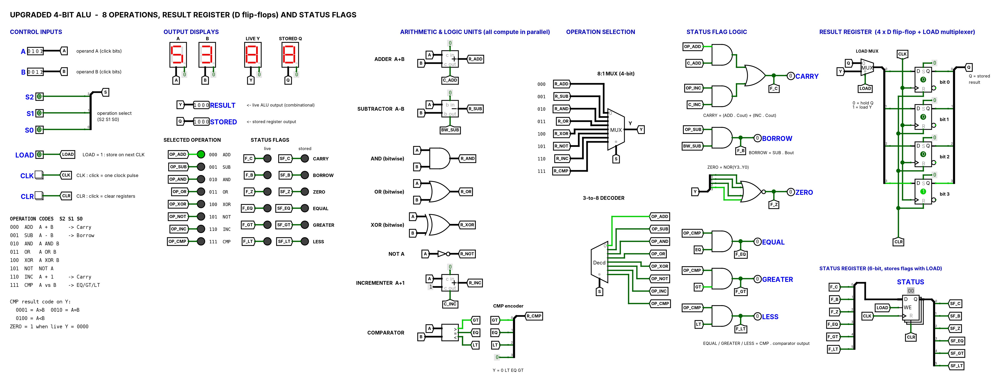

# upgraded-4bit-alu-logisim
An 8-operation 4-bit ALU with result and status registers, designed in Logisim Evolution.
# Upgraded 4-Bit ALU Using Logisim Evolution

An educational digital logic design implementing eight arithmetic, logical and comparison operations, with a result register and status flags.

## Project Overview

This project implements a 4-bit Arithmetic Logic Unit (ALU) using Logisim Evolution. It accepts two 4-bit operands, selects an operation using three control bits, and produces a 4-bit result.

The design also includes a result register and a status register to demonstrate sequential logic and data storage.

## Features

- Eight selectable operations
- 4-bit ALU output
- Multiplexer-based operation selection
- Comparator for greater-than, equal-to and less-than conditions
- Four D flip-flops for storing the result
- Six status flags
- LOAD, CLK and CLR controls
- Test vectors for checking operation outputs and status flags

## Supported Operations

| Select Code | Operation | Function |
|---|---|---|
| 000 | ADD | A + B |
| 001 | SUB | A − B |
| 010 | AND | A AND B |
| 011 | OR | A OR B |
| 100 | XOR | A XOR B |
| 101 | NOT | NOT A |
| 110 | INC | A + 1 |
| 111 | CMP | Compare A and B |

The three-bit selection code chooses one of eight operations.

## Status Flags

The design includes six status flags:

- **Carry:** Indicates carry-out for supported arithmetic operations.
- **Borrow:** Indicates a borrow during subtraction.
- **Zero:** Indicates that the 4-bit ALU result is zero.
- **Equal:** Indicates A = B during comparison.
- **Greater:** Indicates A > B during comparison.
- **Less:** Indicates A < B during comparison.

The status register stores these flags when a write is permitted.

## Result Register

The result register uses four D flip-flops to store the selected 4-bit ALU result.

- **LOAD:** Selects whether to load new data or retain the old value.
- **CLK:** Provides the clock event for storing data.
- **CLR:** Clears the stored state according to the circuit implementation.

The live ALU output can change while the stored result remains unchanged.

## Tools and Technologies

- Logisim Evolution
- Digital logic design
- Combinational and sequential circuits
- Multiplexers and decoders
- D flip-flops and registers

## How to Open the Project

1. Install Logisim Evolution.
2. Download or clone this repository.
3. Open `ALU_4bit_Upgraded.circ` in Logisim Evolution.
4. Use the Poke Tool to change operands and operation-select bits.
5. Observe the live result, stored result and status flags.
6. Refer to `ALU_Quick_Guide.md` for the project's operating instructions.

## Testing

The repository includes:

- `ALU_test_vector_13_cases.txt` — selected test cases covering operations and important flag conditions.
- `ALU_test_vector_exhaustive.txt` — a set of 2,048 combinations covering all 16 × 16 operand pairs across eight operation codes.

Use the supplied guide and the available Logisim test-vector workflow to run the tests. The presence of test vectors alone does not mean every test has been executed.

## Repository Contents

- `ALU_4bit_Upgraded.circ` — circuit file
- `ALU_main_circuit.png` — circuit diagram
- `ALU_Quick_Guide.md` — usage guide
- `ALU_test_vector_13_cases.txt` — selected test cases
- `ALU_test_vector_exhaustive.txt` — exhaustive input combinations

## Learning Outcomes

Through this project, we explored arithmetic and logical operations, binary selection codes, multiplexers, decoders, registers, clocked storage, status flags and digital circuit testing.

This project was developed as an educational exercise in digital electronics and computer architecture.
## Circuit Diagram

